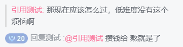
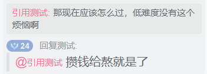

# Bilibili直播引用弹幕显示

## 概述

Bilibili 直播间的聊天栏里, 弹幕经常用「@某人」的方式接话, 但被 @ 的人之前说了什么, 往往已经滚出聊天栏, 看得一头雾水.

本脚本会在这种引用弹幕的上方补上一小段引用块: 被 @ 的观众的昵称, 加上他/她最近一条弹幕的内容——文字或表情图片.

## 效果展示



上方浅灰色竖线部分就是脚本补上的引用内容.

---

本脚本也可以与[Bilibili直播评论样式修改 _v1.0.4+_](https://scriptcat.org/zh-CN/script-show-page/5757) 联动显示, 更改后的样式为: 




## 功能特性

- **引用内容回显**: 检测到弹幕引用了其他观众时, 自动在这条弹幕上方插入被引用者的最后一条发言
- **文字与表情都支持**: 文字弹幕原样显示, 表情弹幕显示为小尺寸图片
- **新弹幕即时处理**: 监听聊天栏变化, 新出现的引用弹幕同样会补上引用块
- **启动时补全历史**: 脚本加载时会先扫描聊天栏里已有的引用弹幕
- **只读展示**: 不改变弹幕内容, 也不影响发送行为, 只在聊天栏里插入额外的展示元素
- **开箱即用**: 没有配置项, 安装后打开直播间即生效

## 使用方法

安装用户脚本管理器, 推荐使用 [脚本猫](https://scriptcat.org/zh-CN):

1. 安装脚本猫浏览器扩展
2. 打开脚本详情页, 点击 **安装脚本** 按钮
3. 进入任意 Bilibili 直播间 (`https://live.bilibili.com/*`), 脚本自动生效

## 示例

### 基础示例

聊天栏里, 观众 B 先发了一条「先点这里再点那里」, 随后观众 A 回复:

```
观众A: @观众B 这个操作是什么意思?
```

脚本会在观众 A 的这条弹幕上方显示:

```
观众B: 先点这里再点那里
观众A: @观众B 这个操作是什么意思?
```

### 高级示例

- 被引用的是**表情弹幕**时, 引用块里显示的是表情图片 (约 32 × 32 的小图), 而不是表情文字
- 多条弹幕先后引用同一位观众时, 每条引用弹幕都会各自带上引用块, 互不影响

## 已知限制

- 只能引用聊天栏里仍然存在的弹幕: 被 @ 的观众最后一条弹幕如果已被 B 站清理 (滚出聊天栏), 就显示不出引用内容
- 只处理直播间聊天栏 (`#chat-items`) 里的弹幕, 其他区域不生效
- 引用块只是展示辅助, 不会补发弹幕, 也不会修改原弹幕

## 许可证

[GPL-3](https://www.gnu.org/licenses/gpl-3.0.zh-cn.html)

## 问题反馈

如有问题或建议, 请联系:

- 邮箱: aluibyiero@qq.com
- Github Issue: https://github.com/AliubYiero/Yiero_WebScripts/issues

**功能增加模板**

```
脚本名称: Bilibili直播引用弹幕显示
脚本版本: 0.1.0
需要的新功能:
[...]
```

**Bug提交模板**

```
脚本名称: Bilibili直播引用弹幕显示
脚本版本: 0.1.0
使用的浏览器及其版本: [如 Google Chrome 版本 142.0.7444.61（正式版本） （64 位）]

出现的问题:
[...]

重现步骤:
1.
2.
3.

补充(如报错截图):
```
